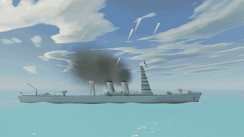

# Combat naval — simulation de la Seconde Guerre mondiale

Une simulation de batailles navales **autonome** sur un océan temps réel en **WebGPU**.
Vous composez les flottes (6 nations × 5 types de navires réels), vous les faites apparaître sur l'eau,
vous changez de caméra pour les suivre, puis vous lancez le combat : l'IA pilote tous les navires, qui se
tirent dessus jusqu'à ce qu'il ne reste qu'une équipe.


## Bande-annonce — version 0.0.1

[](docs/trailer-v0.0.1.mp4)

▶ [**Voir la bande-annonce complète** (MP4, 48 s, 1280×720, 15 Mo)](docs/trailer-v0.0.1.mp4)

Toutes les images sont rendues par le jeu lui-même, image par image (rendu WebGPU logiciel, environ 3 h de calcul sans carte graphique), les
sons sont ceux du jeu et la musique est synthétisée par programme. Les plans sont cadrés par script (`js/trailerScenes.js`) ; pour deux
d'entre eux (la bombe sur le croiseur et la torpille sur le Takao), l'arme est placée près de sa cible pour que l'impact tombe dans le
champ de la caméra : l'impact lui-même est calculé par le vrai modèle de dégâts du jeu. Voir `tools/trailer/README.md` pour refaire la vidéo.

## Lancer le jeu

Il faut un Chrome (ou Edge) récent avec WebGPU et une carte graphique correcte.

- **Le plus simple** : ouvrir `naval.html` (fichier autonome, fonctionne depuis le disque, sans serveur).
- **Depuis les sources** :

```
npm install
npm start          # http://localhost:8080/
npm run build      # régénère naval.html (esbuild)
npm test           # vérifie les modèles, les dégâts localisés, l'aviation et simule des batailles complètes (sans GPU)
```

Si la machine est lente : *Réglages* (touche `H`) → « Résolution de rendu ». Sur un portable, forcer Chrome
sur la carte graphique dédiée.

### Continuer le développement depuis un autre poste

```
git clone https://github.com/FreedomFR/warthunderv2 && cd warthunderv2
git checkout main && git pull          # ou la branche de travail
npm install                            # seulement pour les outils (playwright-core, esbuild)
npm start                              # http://localhost:8080/
npm test                               # sans carte graphique
```

- **Outils dans le navigateur** (`npm run check:shaders`, `npm run smoke`, `tools/trailer`, `tools/refs`) : ils pilotent Chrome en mode
  sans fenêtre. Par défaut ils utilisent le rendu logiciel (SwiftShader : marche partout mais lent) ; avec une carte graphique, lancer
  avec `GPU=hardware` (par exemple `GPU=hardware npm run smoke`, sous Windows `set GPU=hardware` avant la commande). `CHROME=chemin`
  choisit un autre navigateur. Mode matériel vérifié sur une RTX 3080 (Windows + WSL2) : environ 60 images/s au lieu de 10 à 25 s par image.
- **Sous WSL2** : le Chrome Linux n'y voit pas la carte graphique (pas de pilote Vulkan pour D3D12 dans Mesa sous Debian), il retombe sur
  SwiftShader. Garder le serveur dans WSL et lancer les outils avec le Node **Windows**, qui pilote le Chrome Windows (D3D12) et atteint
  `localhost:8080` dans WSL :
  `GPU=hardware WSLENV=GPU "/mnt/c/Program Files/nodejs/node.exe" tools/smoke.mjs` (de même pour `tools/wgslcheck.mjs`, `tools/trailer/record.mjs`…).
- La bande-annonce (`tools/trailer`) demande aussi `ffmpeg` ; les planches de comparaison (`tools/refs/sheet.py`) demandent Python et Pillow.
- Pour reprendre avec Claude Code : le fichier `CLAUDE.md` décrit le projet, les commandes, l'organisation du code et la méthode des lots
  « fidélité » ; `TODO.md` liste ce qu'il reste à faire.

## Utilisation

1. **Écran de composition** : choisissez un scénario ou composez vos équipes (nation, classe, nombre de navires,
   2 à 4 équipes, distance entre flottes, graine du combat).
2. **Faire apparaître les flottes** : les navires sont posés sur l'eau en formation, immobiles. Les modifications
   suivantes se voient immédiatement. Changez de caméra, regardez-les de près.
3. **Lancer le combat** : tout est autonome. Accélérez le temps (0,5× à 8×) ou mettez en pause.
4. À la fin, un écran de victoire résume les dégâts, tirs, touches et navires coulés.

| Composition des flottes | Impact sur le Yamato | Vue tactique |
|---|---|---|
|  |  |  |

### Caméras (touches 1 à 9)

| Touche | Caméra |
|---|---|
| 1 | **Auto** : un réalisateur suit l'action (navires touchés, salves, naufrages) et alterne les plans |
| 2 | **Poursuite** derrière le navire sélectionné (glisser : orbiter, molette : zoom) |
| 3 | **Orbite** lente autour du navire |
| 4 | **Passerelle** : vue depuis le pont de commandement |
| 5 | **Obus** : suit les obus tirés jusqu'à l'impact |
| 6 | **Tactique** : vue de dessus (glisser : déplacer, molette : altitude) |
| 7 | **Libre** : ZQSD / WASD, Espace / Ctrl pour monter / descendre, Maj = rapide |
| 8 | **Avions** : suit un avion. `V` change de vue : poursuite derrière l'appareil (le long de sa trajectoire, donc dans le piqué), passage devant l'avion, ou vue depuis le pont du navire attaqué. `N` / `B` : avion suivant / précédent. Après un écrasement, la caméra reste sur l'impact |
| 9 | **Cockpit** : vue du pilote (verrière ouverte), glisser pour regarder autour |

`N` / `B` (ou `Tab`) : navire suivant / précédent (avion suivant / précédent en caméras 8 et 9). Le réalisateur automatique (touche 1) coupe aussi sur les largages de bombes et de torpilles et sur les avions touchés. Un clic sur un navire le sélectionne, ainsi qu'un clic dans la
liste des équipes. `Espace` : pause. `,` et `.` : ralentir / accélérer. `L` : plaques de nom. `H` : réglages de
l'océan, du ciel et de la qualité. `F1` : aide.

## Les navires

Chaque navire est un modèle 3D **construit par le programme à partir de la fiche technique du vrai bâtiment**
(longueur, largeur, tirant d'eau, tonnage, vitesse, position des tourelles / cheminées / mâts / îlot, calibres,
nombre de tubes lance-torpilles, blindage, balistique). Il n'y a aucun fichier de modèle 3D.

| Nation | Destroyer | Croiseur léger | Croiseur lourd | Cuirassé | Porte-avions |
|---|---|---|---|---|---|
| États-Unis | Fletcher | Cleveland | Baltimore | Iowa | Essex |
| Japon | Kagerō | Agano | Takao | Yamato | Shōkaku |
| Royaume-Uni | Tribal | Town (Belfast) | County (Norfolk) | King George V | Illustrious |
| Allemagne | Type 1936A (Mob) | Königsberg | Admiral Hipper | Bismarck | Graf Zeppelin |
| France | Le Fantasque | La Galissonnière | Algérie | Richelieu | Béarn |
| Italie | Soldati | Raimondo Montecuccoli | Zara | Littorio | Aquila |

Les fiches sont dans `js/game/data/specs/` (avec leurs sources). Les champs que les sources ne donnaient pas
(positions précises des tourelles, hauteurs de mâts…) sont marqués `estimated` : ce sont des estimations d'après le
profil connu du navire, donc certains détails peuvent différer légèrement de l'original. Le *Graf Zeppelin* et
l'*Aquila* n'ont jamais été achevés ; ils sont modélisés d'après leur conception réelle.

**Détails visuels** (version 0.0.1) : occlusion ambiante précalculée dans les sommets, tôlerie en relief, **camouflages** selon les
livrées de chaque classe (dazzle, Admiralty, « sunburst » italien, taches japonaises), **pavillons nationaux** qui flottent au vent (le
pavillon allemand est la Reichskriegsflagge d'avant 1935, sans svastika), **numéros de coque** dessinés, tourelles, garde-corps,
canots sur bossoirs, radeaux, gréement et pavillons de signaux. Les détails fins ne sont dessinés que de près, les navires hors champ ne
sont pas dessinés et la qualité s'adapte à la machine (*Réglages* → « Qualité » : auto / haute / moyenne / basse).

**Lot 1 « fidélité »** (Iowa, Yamato, Bismarck, Essex), d'après des photographies et plans libres de droits :
- **Navires relevés sur plans** : positions des tourelles, cheminées, mâts, tours, pièces secondaires, directeurs de tir, catapultes et hangars,
  largeurs du pont et de la flottaison, francs-bords ; chaque plan est superposé au modèle pour vérifier (`tools/refs/overlay.py`).
- **Tourelles à dimensions réelles** (`js/game/model/mounts.js`) : triple 16"/50 Mk 7 de l'*Iowa* (longue et basse : 3,4 m de haut, entraxe des
  tubes 3,05 m), triple 46 cm Type 94 du *Yamato* (4,3 m de haut, 18,5 m de long, bouche claire), double 38 cm Drh LC/34 du *Bismarck*, triple
  15,5 cm du *Yamato* sur ses hautes barbettes, double 15 cm du *Bismarck*, double 5"/38 Mk 28 et simple Mk 30 de l'*Essex*. Chaque tube a sa vraie bouche, sa tige de piston de recul et sa position de départ du
  projectile ; le recul suit une courbe réelle (course rapide, retour hydraulique lent).
- **Superstructures** : ponts successifs du château de l'*Iowa* (7 niveaux), pagode à 9 étages du *Yamato*, tour du *Bismarck*, îlot de l'*Essex* ;
  livrées « dazzle » de 1944 pour l'*Iowa* et l'*Essex*.
- **Effets de tir** : flamme de bouche en trois temps (éclair blanc, boule de feu orange à cœur blanc qui refroidit et s'éteint, anneau de fumée
  brune puis nuage de poudre), souffle qui creuse l'écume et soulève l'eau sous la volée, gîte du navire sous l'effet du recul. Les boules de feu
  sont des particules à part (`FIREBALL`), les particules ne sont plus coupées net par la surface de la mer, et le rendu s'adapte au calibre
  (de 5" à 46 cm) et à la distance.

## Les avions

Chaque porte-avions embarque les appareils de sa nation, modélisés d'après les avions réels : **SBD Dauntless** et
**TBF Avenger** (USA), **Aichi D3A « Val »** et **Nakajima B5N « Kate »** (Japon), **Skua** et **Swordfish** biplan (Royaume-Uni),
**Ju 87 Stuka** (avec sa sirène) et **Fi 167** (Allemagne), **LN.401** et **PL.10** (France), **Re.2001** (Italie).
Les croiseurs et cuirassés ont aussi leur hydravion sur la catapulte (Kingfisher, Walrus, Arado 196...).

| Les appareils (SBD, TBF, Swordfish, Stuka) | Torpilleur à basse altitude | DCA et fumée de combat |
|---|---|---|
|  |  |  |

- **Pont d'envol** : les avions attendent en file, roulent sur le pont et décollent un par un ; ceux qui restent garés disparaissent du pont à
  mesure que les vagues partent. Au retour, circuit d'appontage, approche sur une pente de 3,5°, brin d'arrêt, remise de gaz si l'approche est ratée.
  Un porte-avions dont le pont est détruit ne peut plus lancer ni récupérer ses avions (ils amerrissent).
- **Bombardiers en piqué** : montée vers l'objectif, mise en piqué sur le dos, piqué à environ 60°, largage vers 500 m, ressource à 4,5 g puis
  retrait à basse altitude. La bombe est un vrai corps balistique : c'est l'endroit où elle tombe qui décide des dégâts.
- **Torpilleurs** : descente progressive jusqu'à 50 m, approche par des azimuts différents autour de la cible (tenaille), passe rectiligne,
  torpille larguée à environ 1 000 m (visible en chute, gerbe à l'amerrissage), dégagement au ras des flots.
- **DCA** : chaque affût est un objet du navire (Oerlikon, Bofors, pom-pom, Type 96...) qui se tourne vers l'avion, tire en rafales avec traceuses,
  et les pièces à double usage (5 pouces, 105 mm...) tirent des obus fusants qui explosent en nuages noirs. Un affût détruit ne tire plus.
- **Avions touchés** : fumée, puis flammes, puis l'avion s'écrase **de façon visible** : vrille, pilote tué qui pique, aile arrachée (la pièce tombe
  séparément), moteur coupé et amerrissage plané, ou désintégration en vol d'un avion chargé. L'impact fait une gerbe, une boule de feu et une nappe de
  carburant qui brûle sur l'eau ; un avion qui tombe sur un navire lui cause de vrais dégâts.

## Dégâts : là où ça touche

| Cheminée détruite : l'épave remplace la pièce, qui vole en morceaux | Torpille : colonne d'eau contre la coque | Plan des dégâts du navire sélectionné |
|---|---|---|
|  |  |  |

Un navire n'a pas une seule barre de vie : il est fait de **modules** placés là où ils sont sur le modèle 3D : chaufferies et salles des machines,
soutes à munitions sous chaque tourelle, appareil à gouverner, lignes d'arbres, passerelle, directeurs de tir, radars, cheminées, mâts, tubes
lance-torpilles, catapultes, hangar, soute à essence et pont d'envol des porte-avions, chaque affût de DCA, plus des **compartiments étanches**.

- Un impact est suivi à travers le navire : touche une tourelle, un affût, une cheminée, la passerelle, la superstructure, le pont ou la coque.
  Le blindage et l'obliquité décident si l'obus pénètre ; un obus perforant éclate après son retard de fusée, donc **à l'intérieur** si la coque est
  assez profonde (il traverse un destroyer sans éclater), un obus explosif éclate sur la surface (ou juste derrière une tôle mince).
- L'explosion endommage chaque module selon sa distance au point d'éclatement et selon qu'il est protégé (machines sous le pont blindé) ou exposé
  (DCA, directeurs, mâts) : un 5 pouces tue une DCA, pas une tourelle ; un 406 mm dans la chaufferie la détruit.
- Effets : machines perdues (vitesse), ligne d'arbre perdue (le navire tire d'un bord), gouvernail bloqué (il tourne en rond), directeurs et radar
  détruits (tir moins précis), passerelle détruite (commandement dégradé), cheminée perdue (vitesse), tourelle enrayée ou sans munitions,
  tubes lance-torpilles qui explosent, hangar en feu, DCA qui se tait.
- **Éléments détruits visibles** : cheminées, mâts, passerelle, directeurs, radars, catapultes, tubes et tourelles sont remplacés par leur épave
  (souche calcinée, tourelle tordue) et leurs morceaux **volent** et retombent à la mer. Chaque impact laisse une **cicatrice** sur la coque.
- **Inondation** : 8 à 18 compartiments par navire. Une torpille inonde ceux qui sont près de l'impact, du côté touché : gîte, assiette (par l'avant ou par
  l'arrière), enfoncement ; le navire sombre selon l'eau qu'il a embarquée. Les pompes et l'équipe de sécurité colmatent peu à peu.
- **Incendies** : ils chauffent les soutes voisines ; l'équipe de sécurité les noie... ou pas.
- Le panneau du navire sélectionné montre un **plan des dégâts** : modules en vert / orange / rouge, compartiments inondés en bleu, incendies,
  tourelles enrayées, DCA restante.

## Explosions et naufrages

| Explosion de munitions | Croiseur ravagé : cheminées détruites, incendies |
|---|---|
|  |  |

- **Explosion de munitions** : éclair, boule de feu, onde de choc sur l'eau (anneau d'embruns et d'écume), colonne de fumée en champignon, **tourelles
  projetées** hors du navire, pièces enflammées qui retombent, **explosions secondaires** le long de la coque, puis **la coque se brise en deux** et
  les deux sections coulent chacune à leur manière. Les navires voisins et les avions proches sont touchés par le souffle.
- Les naufrages « normaux » se terminent par des explosions de chaudières et de munitions, des craquements de coque, de l'eau qui s'engouffre, puis
  une nappe de mazout qui brûle longtemps à la surface.

## Le son

Tous les sons sont **synthétisés par le programme** (pas de fichiers audio) et joués en 3D : atténuation avec la distance, filtrage des aigus, retard du
son (343 m/s), position stéréo selon la caméra, écho sur la mer. Canons principaux, moyens et petits (chacun son timbre), DCA légère par calibre,
éclatements d'obus antiaériens, sifflement des obus et des bombes qui passent, gerbes, impacts (explosifs, perforants, ricochets, obus qui traversent),
torpilles, explosions de munitions, avaries (structures qui s'effondrent, vapeur des chaudières, étincelles, voies d'eau, craquements de coque),
moteurs d'avions avec effet Doppler, sirène du Stuka en piqué, avion qui tombe, brin d'arrêt, incendies et machines des navires proches.
`M` coupe le son. Le son est coupé au-delà de 2,5× de vitesse du temps.

## La simulation

- **Balistique** : obus avec traînée dépendant de l'altitude, étalonnée pour que la portée à l'élévation maximale
  corresponde à la portée réelle de chaque canon ; tables de tir inversées ; temps de vol réels (≈ 34 s à 20 km
  pour un 406 mm).
- **Conduite de tir** : anticipation du mouvement de la cible *et* du navire tireur, tourelles qui tournent à leur
  vitesse réelle dans leurs secteurs de tir, dispersion qui diminue salve après salve (réglage par observation des
  gerbes), précision dégradée en virage.
- **Dégâts** : obliquité et pénétration face au blindage (ceinture, pont, tourelles), obus AP ou explosifs, incendies,
  voies d'eau et gîte, tourelles détruites, avaries de machines et de gouvernail, explosions de soute, naufrage
  (chavirement, par la poupe ou par l'étrave).
- **Torpilles** (destroyers, croiseurs) avec sillage visible, et **frappes aériennes** des porte-avions (voir plus haut).
- **IA** : choix des cibles, distance de combat selon la classe, circulation, zigzag, évitement des collisions,
  attaques à la torpille, repli quand le navire est en perdition, porte-avions qui se tiennent à distance.
- **Mer** : les navires flottent sur la houle FFT (roulis, tangage, pilonnement) et laissent un sillage d'écume
  (étrave, flancs, hélices, bras divergents).

## Contrôle manuel (préparé, pas encore branché)

Un navire n'a pas de logique propre : il exécute une `ShipCommand` (`js/game/sim/ship.js`) écrite par un
*contrôleur*. L'IA (`controllers/ai.js`) et le futur contrôleur manuel (`controllers/manual.js`) écrivent exactement
la même commande : régime moteur, barre ou cap, cible / point de visée par groupe d'armes, tir, torpilles, avions.
Prendre le contrôle d'un navire se résume à :

```js
ship.controller = new ManualController(etatDesEntrees);
```

Les tourelles, la conduite de tir, les rechargements et les salves sont déjà gérés par le navire.

## Organisation du code

| Chemin | Contenu |
|---|---|
| `index.html` | Page, interface (CSS) |
| `js/engine.js` | Moteur d'océan réutilisable (crochets de jeu, sonde de hauteur d'eau, tampons d'écume, ombres, capture) |
| `js/wgsl/` | Shaders : océan, ciel, post-traitement (du projet *web-ocean*) + navires, particules, ombres |
| `js/game/data/` | Fiches des navires (6 nations) |
| `js/game/model/` | Constructeur de maillages procéduraux : coque loftée, superstructures, tourelles, mâts… |
| `js/game/model/planes.js` | Générateur des avions (fuselage loftée, ailes, hélice, train, bombes, torpilles) |
| `js/game/sim/` | Simulation pure (sans GPU) : monde, navires, armes, balistique, aviation (`aircraft.js`), modules et dégâts (`modules.js`, `damage.js`), explosions (`explosions.js`), débris (`debris.js`), contrôleurs |
| `js/game/render/` | Rendu des navires (`shipVisual.js`), des avions (`aircraftVisual.js`), particules, effets, ombres |
| `js/game/audio/` | Synthèse des sons (`synth.js`) ; `js/game/audio.js` : lecture en 3D |
| `js/game/ui/` | Interface, caméras, plan des dégâts |
| `js/trailer.js`, `js/trailerScenes.js`, `js/trailerMusic.js`, `tools/trailer/` | Bande-annonce : réalisateur et scènes (`?trailer=1`), partition synthétisée, enregistreur image par image et montage ffmpeg (voir `tools/trailer/README.md`) |
| `test/` | `models.mjs` (30 modèles), `damage.mjs` (dégâts localisés, explosions), `air.mjs` (aviation), `audio.mjs` (moteur sonore avec une API Web Audio factice), `manual.mjs` (pilotage manuel via ShipCommand), `battle.mjs` / `preset.mjs` (une bataille), `fuzz.mjs` (batailles aléatoires) |

Paramètres d'URL utiles : `?scenario=duel&start=1` (démarrage direct), `seed=123` (combat reproductible),
`mode=orbit`, `speed=4`, `scale=0.7` (résolution de rendu), `shadows=0`, `preview=iowa,yamato,plane:sbd` (aperçu de navires et d'avions ; `ruin=1`, `scars=30`, `split=20`, `parked=6` montrent les états endommagés), `quality=low|medium|high` (qualité graphique), `fft=128` et `grid=16` (océan allégé pour les machines lentes), `ocean=0` (sans océan : aperçus de modèles plus rapides).

## Crédits et licence

Le moteur d'océan (vagues FFT, ciel physique, post-traitement, shaders WGSL) vient de
[Noniv/web-ocean](https://github.com/Noniv/web-ocean) (licence MIT, voir `LICENSE` et `NOTICE.md`) ; il a été adapté
ici pour accueillir le jeu. Les caractéristiques des navires proviennent de Wikipédia, NavWeaps et Navypedia.
Pour le lot « fidélité » (Iowa, Yamato, Bismarck, Essex), les proportions des tourelles, des superstructures et des effets de tir ont été relevées
(mesures et observations seulement : aucune image n'est copiée dans le dépôt) sur des photographies de Wikimedia Commons : domaine public pour les
photographies de l'US Navy (*Iowa*, *Essex*) et du *Yamato*, Bundesarchiv (CC BY-SA 3.0 de) pour le *Bismarck*. Les positions, hauteurs et
largeurs ont ensuite été relevées sur des plans : profil et vue de dessus de la classe *Iowa* (domaine public), plans du constructeur du
*Yamato* (NH 111711, domaine public) et profil du *Yamato* en 1945 par Alexpl (CC BY-SA 3.0, d'après les photographies du musée de Kure),
profil du *Bismarck* « Battleship Bismark.svg » (CC0), photographie de profil de l'*USS Ticonderoga* du 5 novembre 1944 (domaine public).
Les hélices de l'*Iowa* d'après les photographies de l'*USS Missouri* en cale sèche (domaine public). Chaque modèle est vérifié en mètres
contre ses plans (`tools/refs/check.mjs`, `silhouette.py`). Lot 2 : feuilles ONI 201 (*Illustrious*) et 202 (*Littorio*) du Division of Naval Intelligence (domaine public), coupe longitudinale de la classe *Richelieu* (CC BY-SA 4.0) et profil + plan du *Shōkaku* (CC BY-SA 3.0, Snow Cloud in Summer) ; pour le *King George V*, une photographie de 1945 (domaine public). La liste complète des sources est dans `tools/refs/sources.jsonl`.
Code sous licence MIT.
