# Combat naval — simulation de la Seconde Guerre mondiale

Une bataille navale **autonome** sur un océan temps réel en **WebGPU** : vous composez les flottes (6 nations × 5 types de navires réels),
l'IA les pilote, et vous regardez le combat sous tous les angles. Les 30 navires et leurs avions sont **construits par le programme** d'après leur
fiche technique : aucun fichier de modèle 3D, aucun fichier audio.

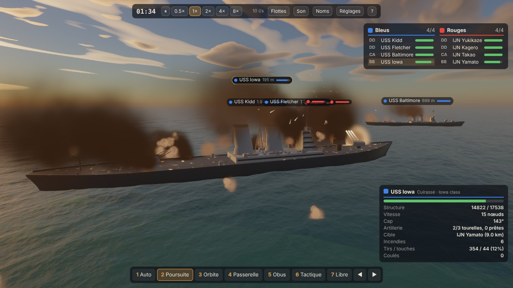

## Sommaire

- [Jouer en 1 minute](#jouer-en-1-minute)
- [Commandes](#commandes)
- [Ce que contient le jeu](#ce-que-contient-le-jeu)
- [Le wiki et le visualiseur 3D](#le-wiki-et-le-visualiseur-3d)
- [Galerie](#galerie)
- [Bande-annonce](#bande-annonce)
- [Les navires](#les-navires)
- [Installation et développement](#installation-et-développement)
- [Documentation technique et crédits](#documentation-technique-et-crédits)

## Jouer en 1 minute

Il faut un Chrome (ou Edge) récent avec WebGPU et une carte graphique correcte.

1. **Ouvrir `naval.html`** : un fichier autonome, il marche depuis le disque, sans serveur.
   (Depuis les sources : `npm install`, puis `npm start` et <http://localhost:8080/>.)
2. Dans le panneau de gauche, choisir un scénario puis **Charger** (ou composer les équipes soi-même), puis **Faire apparaître les flottes**.
3. Changer de caméra avec les touches `1` à `9`, regarder les navires de près, puis **Lancer le combat** : tous les navires sont pilotés par l'IA,
   jusqu'à ce qu'il ne reste qu'une équipe. `Espace` met en pause, `,` et `.` ralentissent ou accélèrent le temps.

**Sur téléphone** : ouvrir l'adresse ci-dessous dans Chrome (Android récent, WebGPU) ; l'interface devient tactile (menu, joystick de caméra libre, plein écran en paysage). « Ajouter à l'écran d'accueil » l'installe comme une application. Détails : [docs/ARCHITECTURE.md](docs/ARCHITECTURE.md#sur-téléphone).

**En ligne** : le jeu, le wiki et le visualiseur sont sur <https://freedomfr.github.io/warthunderv2/> (version stable, `main`) et <https://freedomfr.github.io/warthunderv2/dev/> (version en cours de validation, `dev`) ; voir [la publication](docs/ARCHITECTURE.md#publier-le-site).

Si la machine est lente : `H` (Réglages) → « Résolution de rendu ». Le même panneau règle le nombre maximal de particules (flammes, fumées, gerbes : plus il est haut, moins elles disparaissent dans les grosses batailles) et le son binaural pour casque. Sur un portable, forcer Chrome sur la carte graphique dédiée.

## Commandes

| Touche | Action |
|---|---|
| `1` – `9` | Caméras : auto, poursuite, orbite, passerelle, obus, tactique, libre, avions, cockpit |
| `N` / `B` | Navire (ou avion) suivant / précédent ; un clic sur un navire le sélectionne |
| `Espace`, `,`, `.` | Pause ; ralentir / accélérer le temps (0,5× à 8×) |
| glisser, molette | Orbiter autour du navire, zoom (altitude en vue tactique) |
| `Z Q S D` ou `W A S D`, `Espace`, `Ctrl`, `Maj` | Déplacement en caméra libre (`Maj` = rapide) |
| `V` | En caméra « Avions » : poursuite, passage devant l'avion, vue depuis le navire visé |
| `J` | Journal des impacts : type d'obus, angle, blindage, pénétration, résultat |
| `Tab` (maintenu) | Tableau de bord du combat, en temps réel |
| `L`, `M`, `H`, `F1` | Plaques de nom ; son ; réglages de l'océan, du ciel et de la qualité ; aide |

Les caméras en détail : **1 Auto** (un réalisateur suit l'action), **2 Poursuite**, **3 Orbite**, **4 Passerelle**, **5 Obus** (suit les obus jusqu'à
l'impact), **6 Tactique** (vue de dessus), **7 Libre**, **8 Avions** (suit un avion ; `V` change de vue), **9 Cockpit** (vue du pilote, glisser pour regarder autour).

## Ce que contient le jeu

- **30 navires réels** (6 nations × destroyer, croiseur léger, croiseur lourd, cuirassé, porte-avions), relevés sur plans d'époque : tourelles aux dimensions réelles,
  superstructures, camouflages, pavillons, embarcations, hélices.
- **Aviation embarquée** : bombardiers en piqué, torpilleurs, chasseurs et hydravions de chaque nation ; ascenseurs, ailes repliées, décollage, circuit d'appontage et brins d'arrêt.
- **Dégâts modulaires** : chaufferies, soutes, tourelles, gouvernail, directeurs de tir, DCA, compartiments étanches, inondation, incendies ; les pièces détruites volent et retombent à la mer.
- **Balistique et conduite de tir réalistes** : secteurs de tir calculés sur la géométrie du navire, anticipation, dispersion qui diminue salve après salve.
- **Îles et végétation** : rochers, îles vallonnées et montagneuses tirées de la graine, forêts procédurales selon le climat ; les navires s'échouent, les obus éclatent sur les pentes, la ligne de vue est testée.
- **Flottes et tactique** : vaisseau amiral, ligne en colonne, écran de destroyers, porte-avions à l'abri derrière la ligne, cible commune.
- **Explosions et naufrages** : explosion de munitions, coque brisée en deux, nappes de mazout qui brûlent.
- **Effets** : océan FFT, ciel physique, sillages, gerbes, flammes de bouche à trois temps, fumée, DCA et traçantes.
- **Son synthétisé** par le programme et joué en 3D (distance, retard du son, effet Doppler).

Le détail de chaque point est dans [docs/ARCHITECTURE.md](docs/ARCHITECTURE.md).

## Le wiki et le visualiseur 3D

Deux pages en plus du jeu (elles demandent le petit serveur : `npm start`, car elles lisent les modules du jeu) :

| Page | Adresse (serveur local) | À quoi elle sert |
|---|---|---|
| **Wiki** | <http://localhost:8080/wiki.html> | **Arbres technologiques** par nation (ères, types, silhouettes dessinées d'après les fiches), **comparatif** triable des 30 navires, **aviation**. Un clic sur un navire ouvre sa fiche : chiffres de la fiche technique, valeurs estimées signalées, sources et modèle 3D intégré. |
| **Visualiseur 3D** | <http://localhost:8080/viewer.html> | Tourner autour de n'importe quel navire ou avion : glisser pour orbiter, clic droit ou `Maj` + glisser pour déplacer, molette ou pincement pour zoomer. Lumière (plein jour, matin, coucher de soleil, ciel couvert, crépuscule), océan et ombres à volonté, tourelles pivotées, avions sur le pont, état intact / cicatrices / épaves / coque brisée. |

Le bouton **« Lien de débogage »** du visualiseur copie une adresse qui rouvre exactement la même vue (modèle, angle, distance, lumière, options) :
c'est ce qu'il faut joindre à un rapport de défaut visuel. Le bouton **« Capture »** enregistre une image PNG. Les deux pages fonctionnent aussi sur téléphone.
Exemples : `viewer.html?m=yamato&az=250&el=20&d=300`, `viewer.html?m=plane:sbd`, `wiki.html#/japan/yamato`.

Les chiffres du wiki sont lus dans les mêmes fiches (`js/game/data/specs/`) que celles du jeu : ils ne peuvent pas être en retard.

## Galerie

| Composition des flottes | Impact sur le Yamato | Vue tactique |
|---|---|---|
| 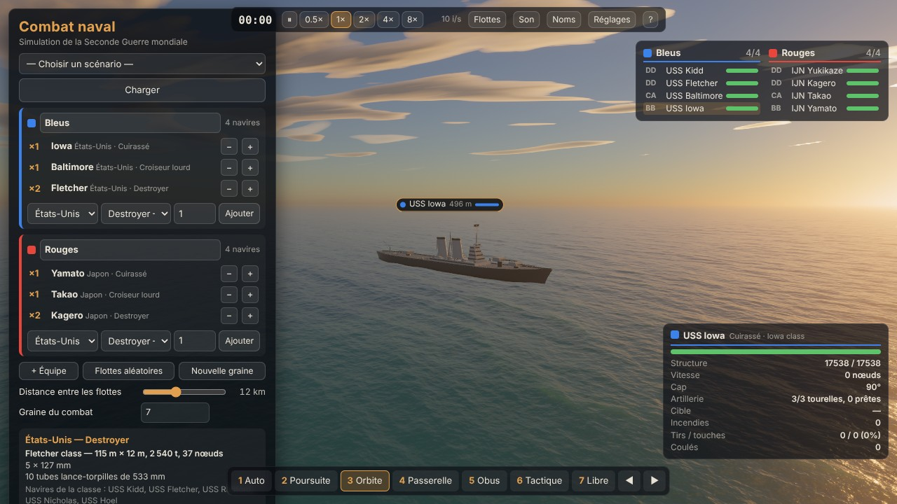 | 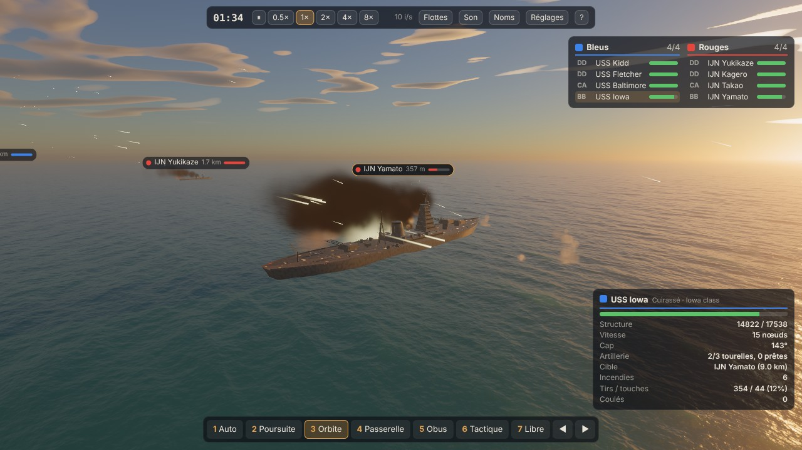 | 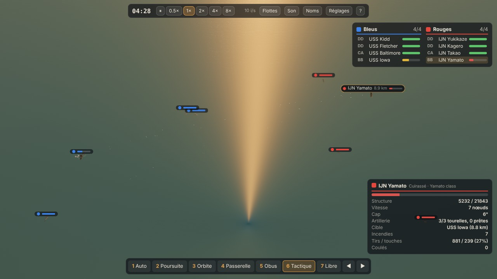 |

| Les appareils (SBD, TBF, Swordfish, Stuka) | Torpilleur à basse altitude | Bombardiers en piqué, DCA et fumée |
|---|---|---|
| 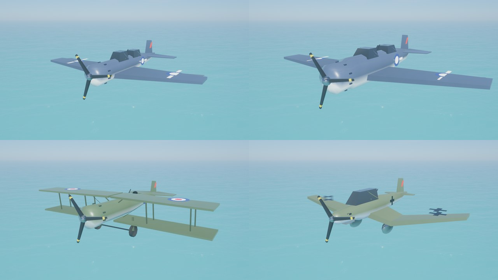 | 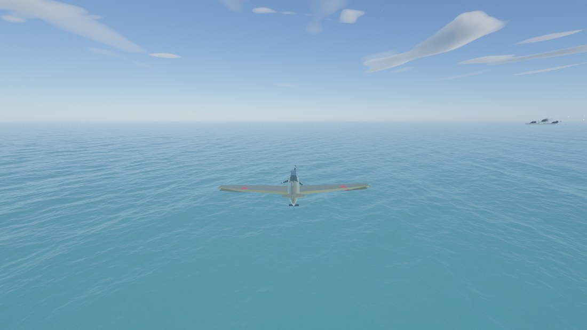 | 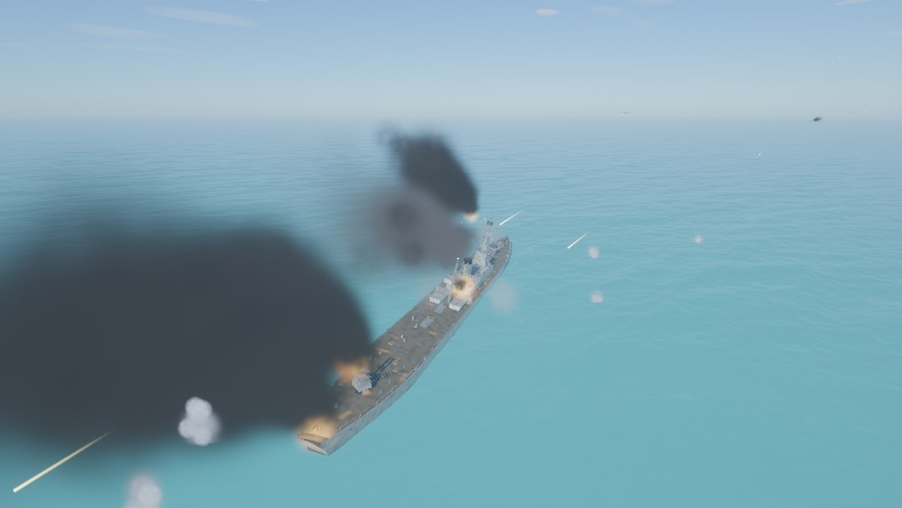 |

| Cheminées détruites sur le Norfolk | Torpille sur le Takao | Plan des dégâts du navire sélectionné |
|---|---|---|
| 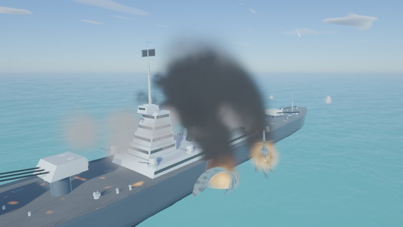 | 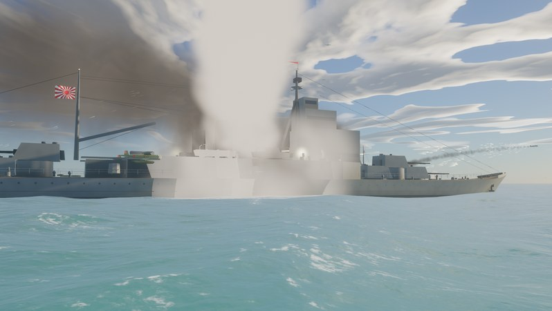 | 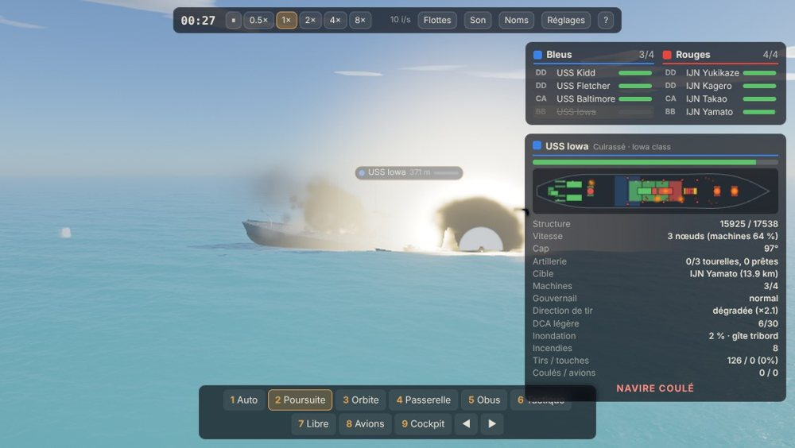 |

| Explosion de munitions | Le croiseur Zara ravagé |
|---|---|
| 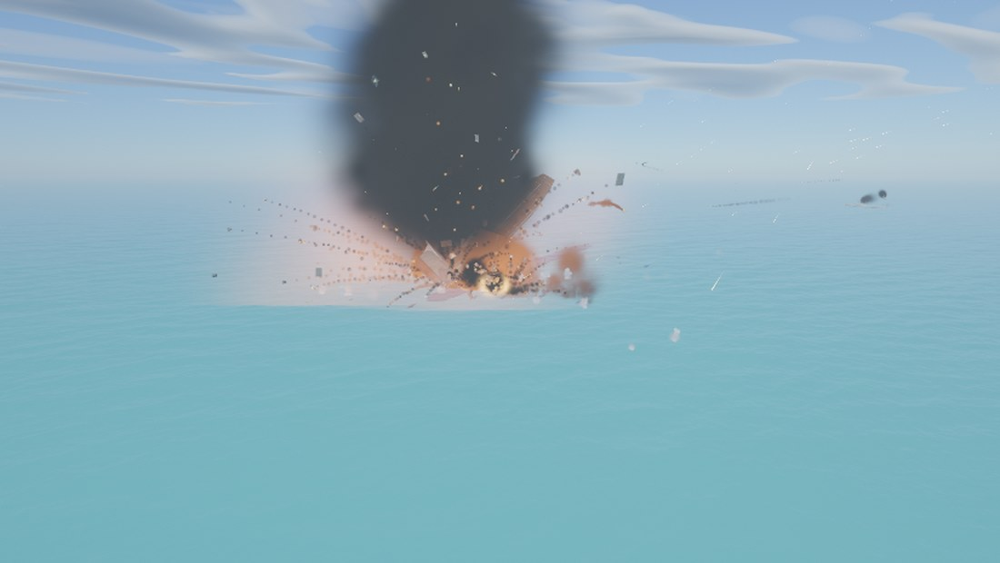 | 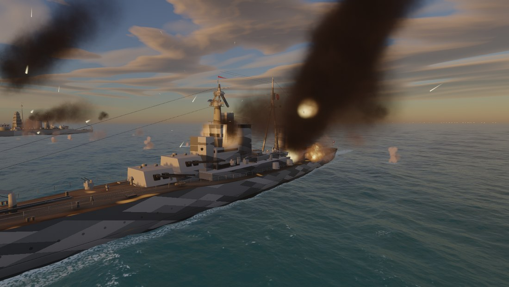 |

## Bande-annonce

[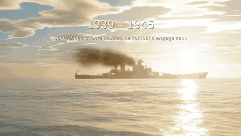](docs/trailer-v0.1.0.mp4)

▶ [**Voir la bande-annonce complète** (MP4, 89 s, 1920×1080, **60 images/s**, 36 Mo)](docs/trailer-v0.1.0.mp4) ·
▶ [Comparatif 0.0.1 / 0.1.0](docs/comparatif-0.0.1-0.1.0.mp4) (48 s) · ▶ [bande-annonce 0.0.1](docs/trailer-v0.0.1.mp4) (48 s)

Toutes les images sont rendues par le jeu lui-même, image par image, les sons sont ceux du jeu et la musique est synthétisée par programme. Les plans sont
cadrés par script (`js/trailerScenes.js`) ; voir `tools/trailer/README.md` pour refaire la vidéo.

## Les navires

| Nation | Destroyer | Croiseur léger | Croiseur lourd | Cuirassé | Porte-avions |
|---|---|---|---|---|---|
| États-Unis | Fletcher | Cleveland | Baltimore | Iowa | Essex |
| Japon | Kagerō | Agano | Takao | Yamato | Shōkaku |
| Royaume-Uni | Tribal | Town (Belfast) | County (Norfolk) | King George V | Illustrious |
| Allemagne | Type 1936A (Mob) | Königsberg | Admiral Hipper | Bismarck | Graf Zeppelin |
| France | Le Fantasque | La Galissonnière | Algérie | Richelieu | Béarn |
| Italie | Soldati | Raimondo Montecuccoli | Zara | Littorio | Aquila |

Les fiches sont dans `js/game/data/specs/` (avec leurs sources). Les champs que les sources ne donnaient pas (positions précises des tourelles, hauteurs de mâts…)
sont marqués `estimated` : ce sont des estimations d'après le profil connu du navire. Le *Graf Zeppelin* et l'*Aquila* n'ont jamais été achevés ; ils sont
modélisés d'après leur conception réelle.

## Installation et développement

```
git clone https://github.com/FreedomFR/warthunderv2 && cd warthunderv2
npm install                # seulement pour les outils (playwright-core, esbuild)
npm start                  # serveur local : http://localhost:8080/ (jeu), wiki.html, viewer.html
npm test                   # modèles, dégâts, son, aviation, batailles complètes : sans carte graphique, environ une minute
npm run build              # régénère naval.html, la version en un seul fichier (esbuild)
npm run check:shaders      # compile les shaders avec un vrai WebGPU (le serveur doit tourner)
npm run smoke              # test de fumée dans le navigateur (le serveur doit tourner)
```

- Les outils qui pilotent un navigateur (`check:shaders`, `smoke`, `tools/trailer`, `tools/refs`) utilisent par défaut le rendu logiciel (lent) ;
  avec une carte graphique, lancer avec `GPU=hardware`. Le détail (WSL2, `CHROME=`) est dans [docs/ARCHITECTURE.md](docs/ARCHITECTURE.md#poste-de-développement-et-outils).
- Pour reprendre avec Claude Code : `CLAUDE.md` décrit le projet, les commandes, l'organisation du code et la méthode des lots « fidélité » ; `TODO.md` liste ce qu'il reste à faire ; `CHANGELOG.md` ce qui a changé.

## Documentation technique et crédits

- [docs/ARCHITECTURE.md](docs/ARCHITECTURE.md) : les navires, les avions, les dégâts, le son, la simulation, l'organisation du code, les paramètres d'URL.
- [docs/CREDITS.md](docs/CREDITS.md) : **crédits et licences** des photographies, plans et sources (dont le moteur d'océan [Noniv/web-ocean](https://github.com/Noniv/web-ocean), licence MIT).
- Code sous licence MIT (voir `LICENSE` et `NOTICE.md`).
